# Визуальная приёмка UI-правок

Снимки `before/` — копии предоставленных пользователем изображений; `after/` — свежие снимки текущей версии интерфейса. После-снимки сделаны в Chromium на viewport, близких к исходным; для macOS дополнительно проверена ветка `darwin`.

## 1. Уведомление Помодоро

| До | После — светлая тема |
|---|---|
| 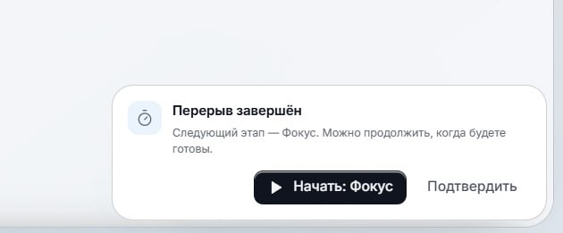 | 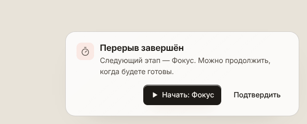 |

Дополнительные проверки:

- 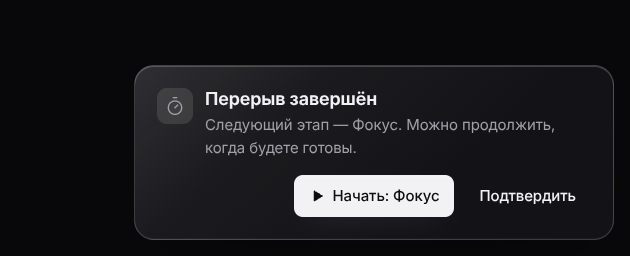
- 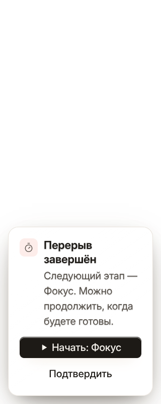

Замеры: ширина 480 px, внутренний отступ 22 px, заголовок 18 px / weight 650, текст 15 px / line-height 22.5 px, кнопки 15 px и 42 px по высоте. При ширине 320 px уведомление сжимается до 288 px, кнопки складываются в столбец; горизонтального переполнения нет. Контраст текста относительно тематической поверхности прошёл AA во всех шести палитрах (минимум 6.94:1 для основного текста в проверке токенов).

## 2. Единые тени карточек и плашек

### «Пароли» — баннер и пустая карточка

| До | После — светлая тема |
|---|---|
| 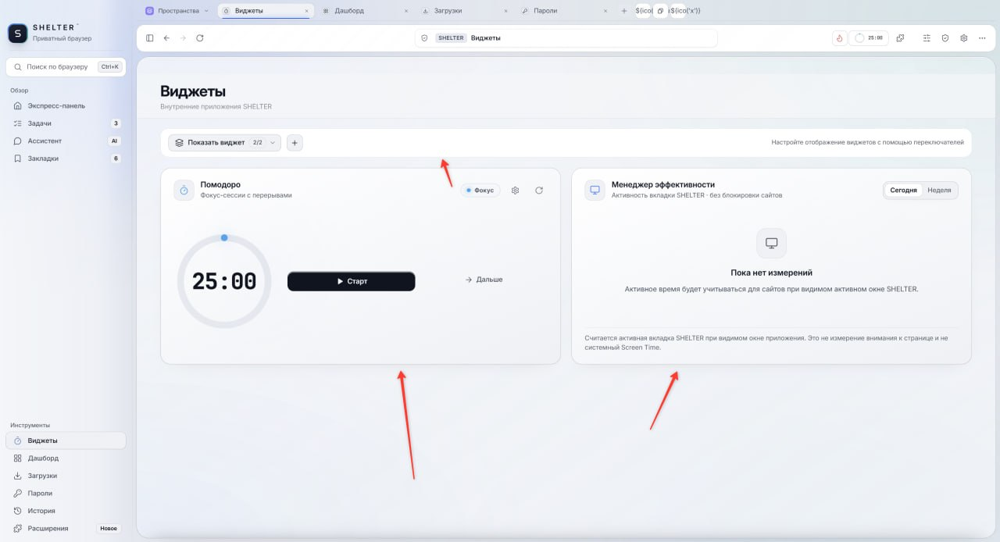 | 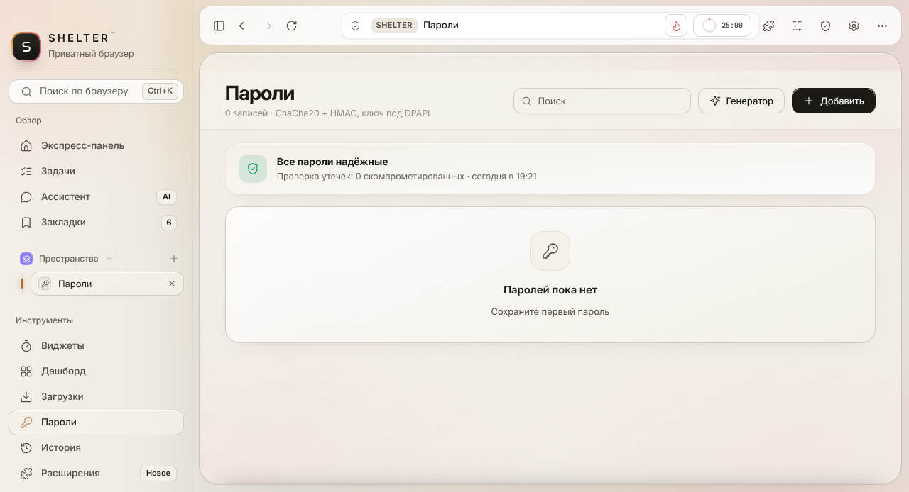 |

### «Виджеты» — карточки Помодоро и менеджера эффективности

| До | После — светлая тема |
|---|---|
| 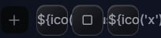 | 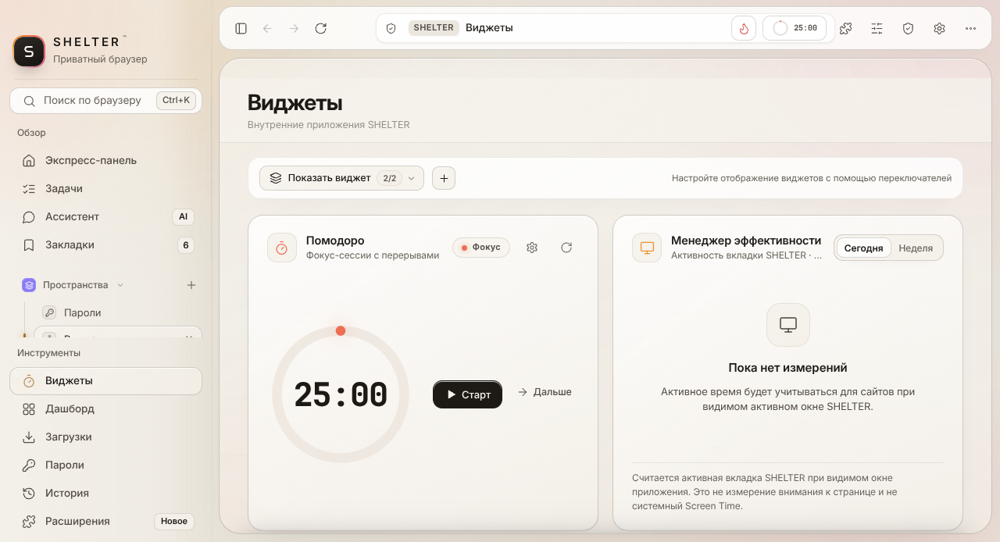 |

Тёмные варианты после правки: [«Пароли»](after/passwords-graphite-after.png) · [«Виджеты»](after/widgets-graphite-after.png).

В браузерной проверке `box-shadow` баннера и `.rows` в «Паролях», карточек виджетов и `.wg-bar` совпал с `--shadow-card` отдельно в светлой и тёмной темах.

## 3. Кнопки управления окном

| До | После — Windows, кнопки в строке вкладок |
|---|---|
| 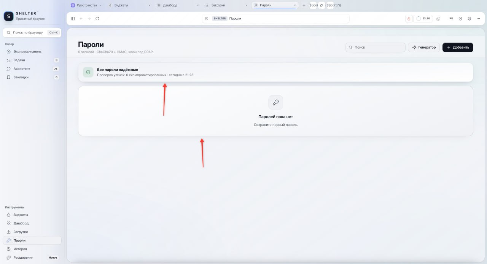 | 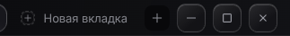 |

- [Полный снимок Windows-строки вкладок](after/window-controls-win-top-after.png)
- [macOS: светофор слева, Windows-кнопки скрыты](after/window-controls-macos-after.png)

В Chromium-ветке `win32` кнопки находятся внутри `#tabTop`, не вызывают горизонтального переполнения и отделены от «+» gap 8 px. Проверены действия minimize/maximize/restore/close и смена aria-label/иконки восстановления. В ветке `darwin` Windows-группа скрыта, слева показаны красный/жёлтый/зелёный индикаторы.

## 4. Равный gap мини-таймера Помодоро

| До | После |
|---|---|
| 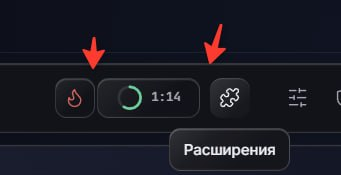 |  |

Измерено: «Огонёк» → таймер — 8 px; таймер → «Расширения» — 8 px. Ширина таймера остаётся 82 px при строках `9:59`, `25:00` и `99:59`, соседняя кнопка не сдвигается.

## 5. Ползунки скругления и прозрачности

| До | После — тёмная тема, крайнее значение |
|---|---|
| 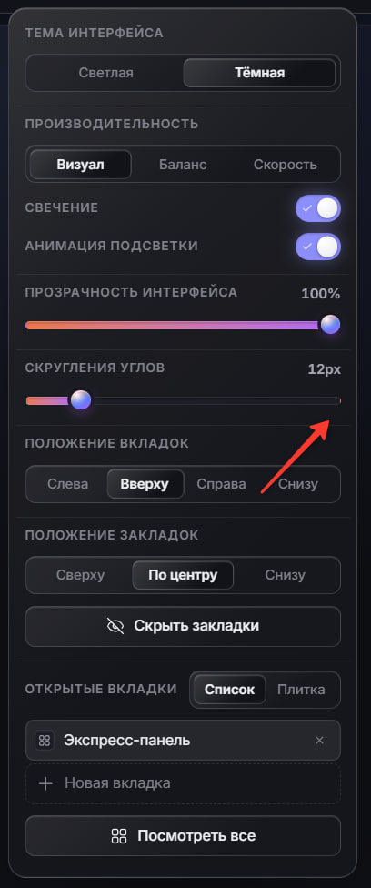 | 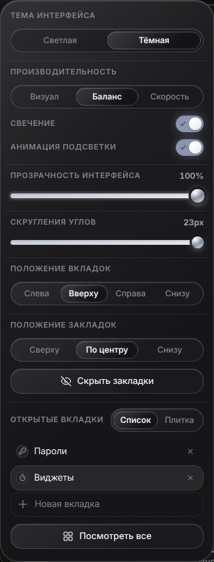 |

Дополнительный светлый вариант: [после в светлой теме](after/range-track-ivory-after.png).

Для двух `.rng` в быстрой панели проверены min / midpoint / max, физическое перетаскивание и крайнее значение; CSS-прогресс синхронизируется от 0% до 100%. Дополнительно прогнаны шесть ползунков настроек свечения/масштаба и ползунок генератора паролей; нет ошибок консоли. CSS-пути `::-webkit-slider-runnable-track` и `::-moz-range-track` покрыты `ui_css_test.js`.

## Тесты и границы проверки

Успешно прошли: `ui_css_test.js` (44/44), `ui_settings_test.js` (56/56), `ui_appearance_test.js`, `ui_window_controls_test.js`, `ui_csp_test.js`, `ui_widgets_test.js`, `ui_build_cache_test.js`, `window_state_source_test.js`. Ошибок консоли в Chromium smoke-проверках нет.

`ui_build_cache_test.js` подтвердил версионированные URL UI/host bridge, `Cache-Control: no-store` и однократную очистку HTTP-кэша при запуске без удаления cookies/localStorage/IndexedDB. Изменения должны применяться без ручной очистки; отдельный cache-баг не выявлен.

Ограничения среды: Windows и macOS/Intel ветки проверены браузерной подменой платформы, а не на физических ОС; macOS-снимок показывает именно ветку `darwin`, но не является запуском на Intel-машине. Firefox/Gecko в среде не установлен: Gecko CSS проверен исходным тестом, однако реальный Firefox drag/screenshot smoke test не выполнялся.

Подробные браузерные замеры: [`browser-checks.json`](browser-checks.json) и [`extra-browser-checks.json`](extra-browser-checks.json).
